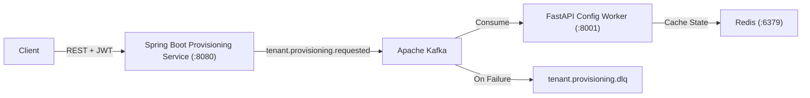

# EventFlow Microservices Platform

Multi-tenant service provisioning and configuration platform built with **Java 17 (Spring Boot)**, **Python (FastAPI)**, **Apache Kafka** (with dead-letter retry topics), **Redis**, and **JWT/RBAC** security.

## Architecture



## Services
1. **`services/provisioning-service`** (Java 17 + Spring Boot 3.2): Exposes tenant provisioning & status endpoints and dispatches provisioning events.
2. **`services/config-worker`** (Python + FastAPI): Enforces JWT/RBAC (`ADMIN`, `OPERATOR`, `VIEWER`), processes provisioning events, routes failures to `tenant.provisioning.dlq`, and logs structured JSON.

## Quickstart

```bash
docker compose up --build
```
